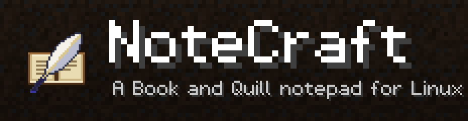
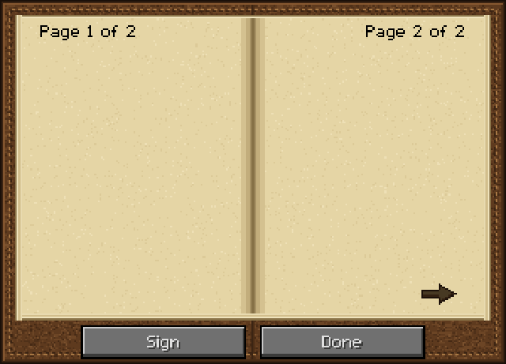
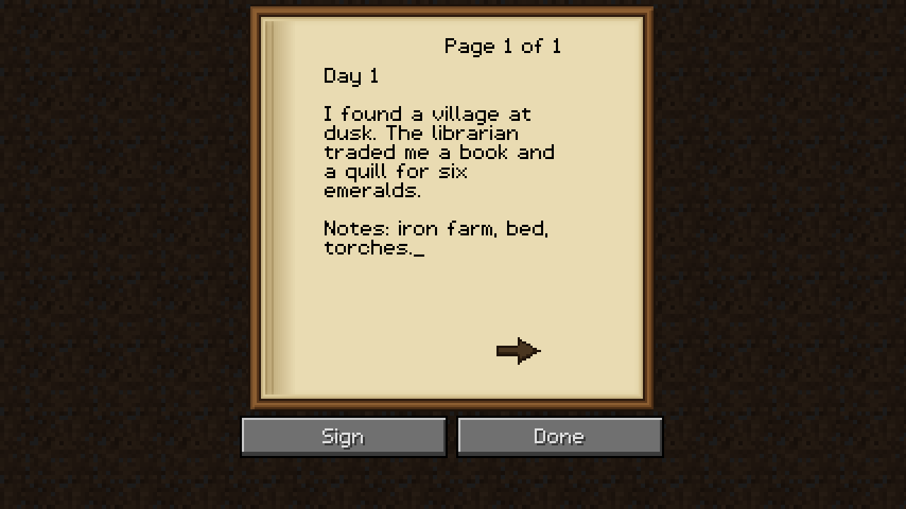
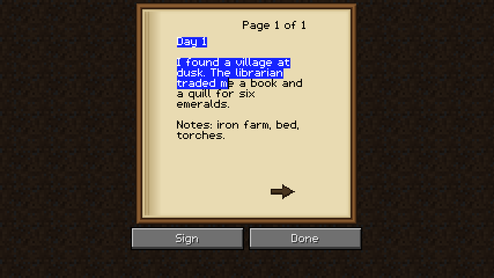
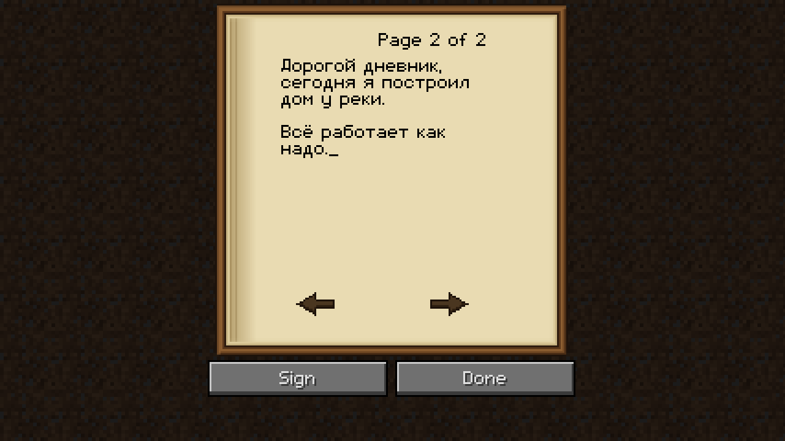
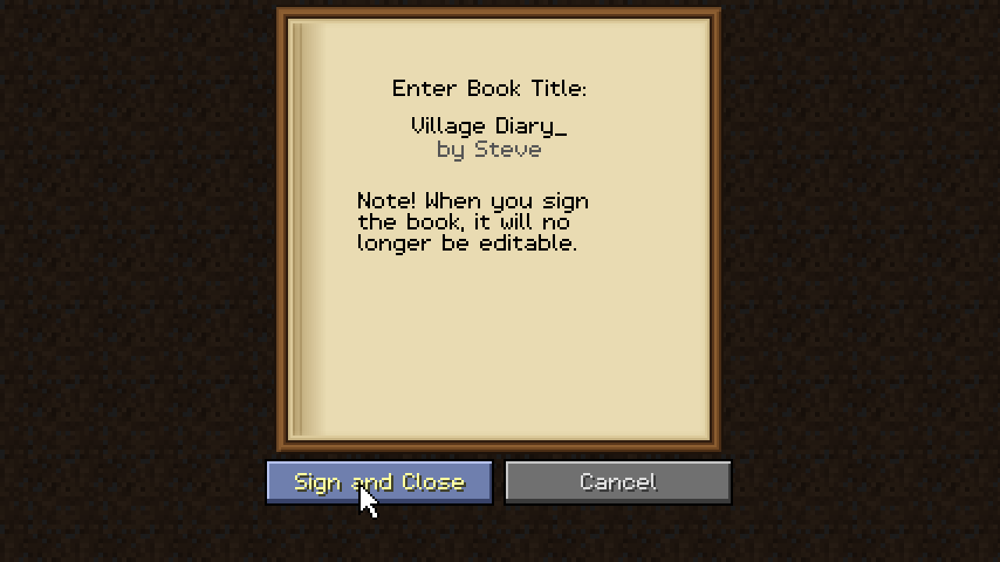
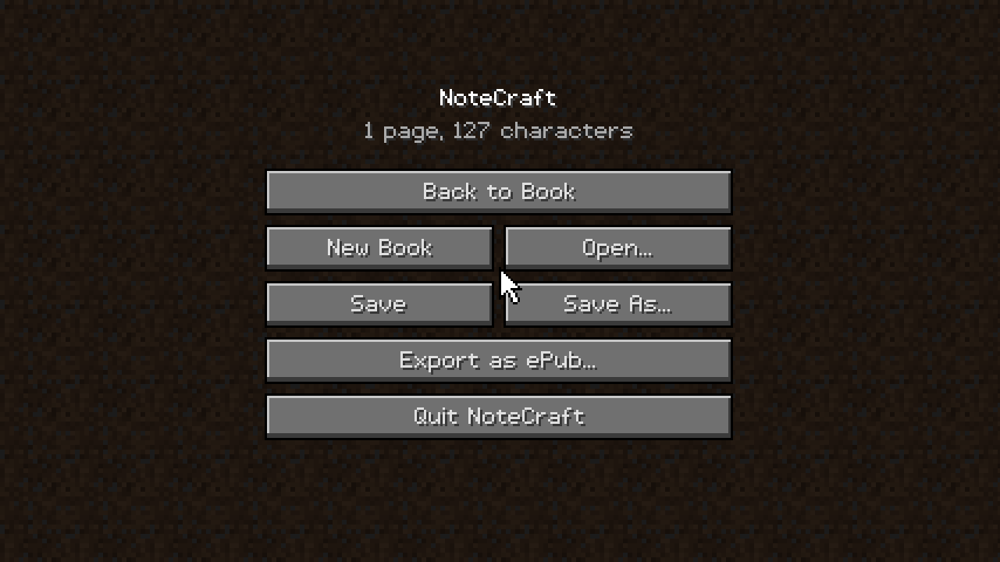
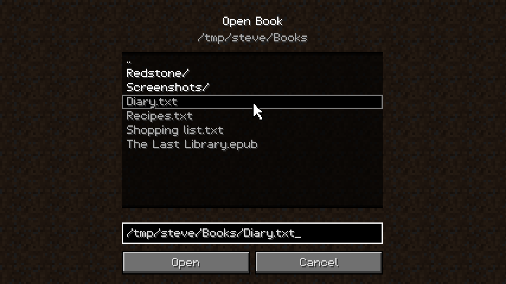

<p align="center">
  
</p>

<p align="center">
  <b>A Book and Quill notepad for your Linux desktop.</b><br>
  Looks and behaves like Minecraft's writable book: the same 114&nbsp;px lines, 14 lines per page, 100 pages, 1&nbsp;023 characters per page.<br>
  A small native C program. No Electron, no web view, no GUI toolkit.
</p>

<p align="center">
  <a href="https://github.com/danielkrinets/NoteCraft/actions/workflows/ci.yml"></a>
  
  
  <a href="README.ru.md">Русский</a>
</p>

<p align="center">
  
</p>

## Features

- **The Minecraft book, as a notepad.** Parchment page, leather frame, page arrows, `Page 1 of 3`, the blinking `_` caret, blue text selection, **Sign** / **Done** buttons, and the "Enter Book Title" screen.
- **Vanilla limits** (Java Edition): 100 pages · 1023 characters per page · 14 lines per page · 114 px line width · titles up to 15 characters. Typing past a limit is simply refused, exactly like in the game.
- **Vanilla word wrap.** The wrapping algorithm is a port of Minecraft's `StringSplitter`: break at the last space, overhanging trailing space, long words are cut between characters.
- **Pixel font with Cyrillic.** A proportional Minecraft-style font drawn from scratch (Latin, digits, punctuation, full Russian alphabet incl. `Ёё`, `«»`, `—`, `№`, `€`…).
- **Plain text (`.txt`).** Open and save UTF-8 text. Pages are separated by a form feed; text without page breaks is flowed into pages automatically.
- **ePub.** Export your book as an EPUB 3 (one XHTML file per page) and open `.epub` files: books made by NoteCraft keep their exact pages, any other ePub is converted to text and paginated.
- **Pages.** Turn pages with the arrows, `PgUp`/`PgDn`, or the mouse wheel; `PgDn` on the last page starts a new one.
- **Signing.** *Sign* a book to give it a title and lock it (read-only view like a Written Book). *Unsign* from the menu to edit again.
- **Native and tiny.** Software-rendered into a low-resolution framebuffer and scaled by an integer GUI scale (like Minecraft's *Auto* setting), so pixels stay crisp on any display, including HiDPI. It redraws only when something changes, so idle CPU use is negligible.
- **Layout-independent shortcuts.** `Ctrl+C`/`V`… work on the Russian keyboard layout too (shortcuts follow the physical key).
- `F2` screenshot (saved to `~/Pictures/NoteCraft/`), `F11` fullscreen, drag & drop a file onto the window.

## Screenshots

| | |
|---|---|
|  |  |
|  |  |
|  |  |

## Install

NoteCraft needs a C compiler, **SDL2** and **zlib**.

```sh
# Debian / Ubuntu
sudo apt install build-essential libsdl2-dev zlib1g-dev
# Fedora
sudo dnf install gcc make SDL2-devel zlib-devel
# Arch
sudo pacman -S base-devel sdl2 zlib

git clone https://github.com/danielkrinets/NoteCraft
cd NoteCraft
make
./notecraft                 # run it in place
sudo make install           # optional: /usr/local/bin + desktop entry + icon
```

```
notecraft [--scale N] [--pack DIR] [file.txt | file.epub]
```

## Controls

| Key | Action |
|---|---|
| `Esc` | Game menu / back |
| `Ctrl+S` / `Ctrl+Shift+S` | Save / Save As (`.txt`) |
| `Ctrl+O` / `Ctrl+N` | Open / New book |
| `Ctrl+E` | Export as ePub |
| `Ctrl+Q` | Quit (asks about unsaved changes) |
| `PgUp` / `PgDn`, arrows, mouse wheel | Previous / next page |
| `←` `→` `↑` `↓`, `Home`, `End` | Move the caret (with `Ctrl`: by word / to page start or end) |
| `Shift` + movement, `Ctrl+A`, double click | Select |
| `Ctrl+C` / `X` / `V` | Copy / cut / paste (a paste that does not fit is cut to what fits) |
| `F2` / `F11` | Screenshot / fullscreen |

## File formats

**`.txt`** — UTF-8. Pages are separated by a form feed (`U+000C`) and every page ends with a newline, so the file stays readable in any editor. A file without form feeds is flowed into pages the way the book would wrap it. On import tabs become four spaces, CR/LF is normalised, and control characters and `§` (which the game cannot type either) are dropped. More than 100 pages of text is truncated, with a warning.

**`.epub`** — export writes EPUB 3 plus an NCX table of contents for old readers; the title comes from signing (or the file name) and the author from `$NOTECRAFT_AUTHOR` / `$USER`. Import reads any DRM-free ePub (ZIP with stored or deflate entries): files created by NoteCraft are restored page for page, everything else is reduced to text (images and styling are dropped) and paginated.

## Resource packs (optional)

The GUI art is generated in code; **no Mojang assets are included**. If you own Minecraft you can make the book look pixel-exact by pointing NoteCraft at a resource pack folder (`--pack DIR`, `$NOTECRAFT_PACK`, or `~/.config/notecraft/pack`) that contains

```
assets/minecraft/textures/gui/book.png                # 256x256, vanilla layout
assets/minecraft/textures/gui/options_background.png  # screen background tile
```

The font cannot be replaced yet.

## How "1:1" is it?

- **Limits** were checked against the [Minecraft Wiki](https://minecraft.wiki/w/Book_and_Quill) (Java Edition).
- **Layout and algorithms** (book at `y=2`, text box `114×126` at `(36,32)`, line height 9, page counter and arrow positions, buttons at `y=196`, word wrap, edit validation, word-wise caret movement, selection drawn with `OR_REVERSE`, 300 ms caret blink, the signing screen) follow Java Edition 1.20's `BookEditScreen` as I know it. I have **not** diffed it pixel by pixel against a real client.
- **Textures and font are original work** in the same style, so they are close but not identical to Mojang's. Use a resource pack (above) for the book texture.

## Development

```sh
make test        # 400 unit/end-to-end checks, no SDL needed
make demo        # headless renderer: screenshots, banner, demo frames
tools/make_media.sh   # regenerate everything in assets/ (needs python3 + ffmpeg)
```

The core (`src/*.c` except `platform_sdl.c`) does not depend on SDL: the whole application renders into a plain framebuffer, which is how the screenshots and the demo are produced from the real code. The tests also run under ASan/UBSan in CI. ePub output is structure-checked (ZIP layout, well-formed XML, manifest/spine) but has not been run through `epubcheck`.

```
src/app.c        screens, input, file dialogs        src/epub.c   ePub export/import
src/layout.c     Minecraft word wrap                 src/zipio.c  ZIP reader/writer
src/field.c      text editing (TextFieldHelper)      src/txt.c    .txt + pagination
src/font.c       pixel font                          src/theme.c  generated textures
```

## Legal

NoteCraft is an unofficial fan project. It is not affiliated with, endorsed by or sponsored by Mojang Studios or Microsoft. *Minecraft* is a trademark of Mojang AB. No Minecraft assets or code are included.

## License

[MIT](LICENSE)
