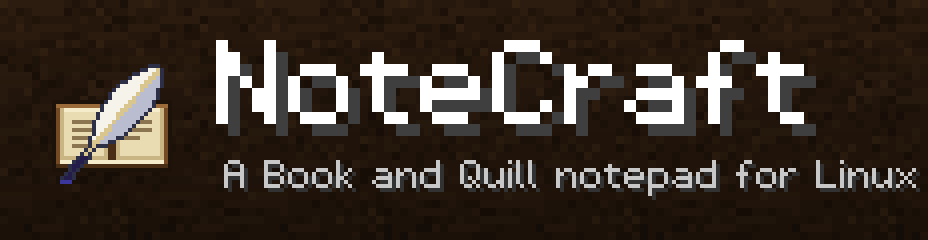
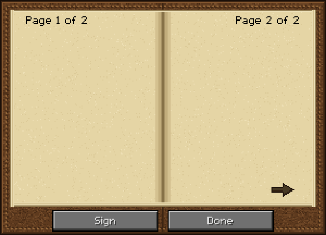
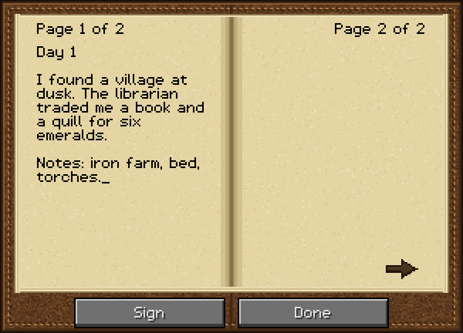
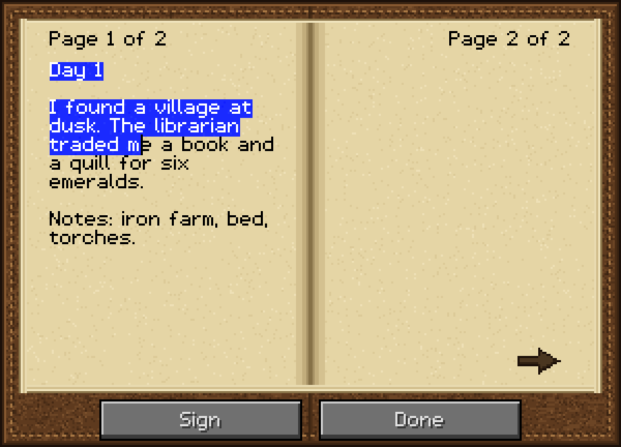
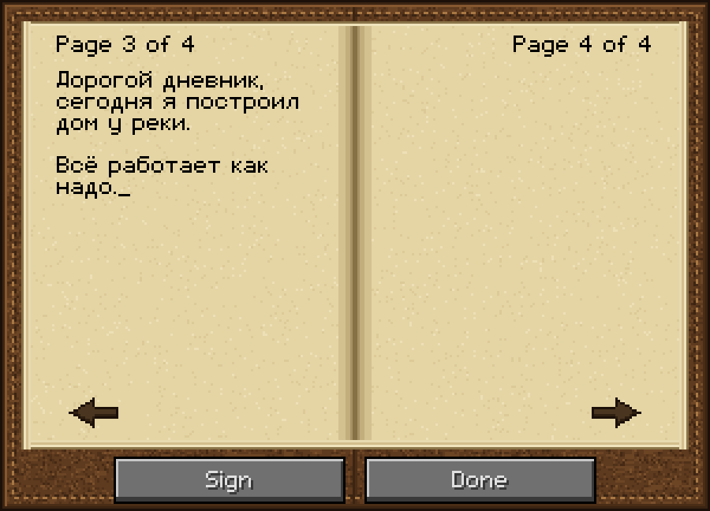
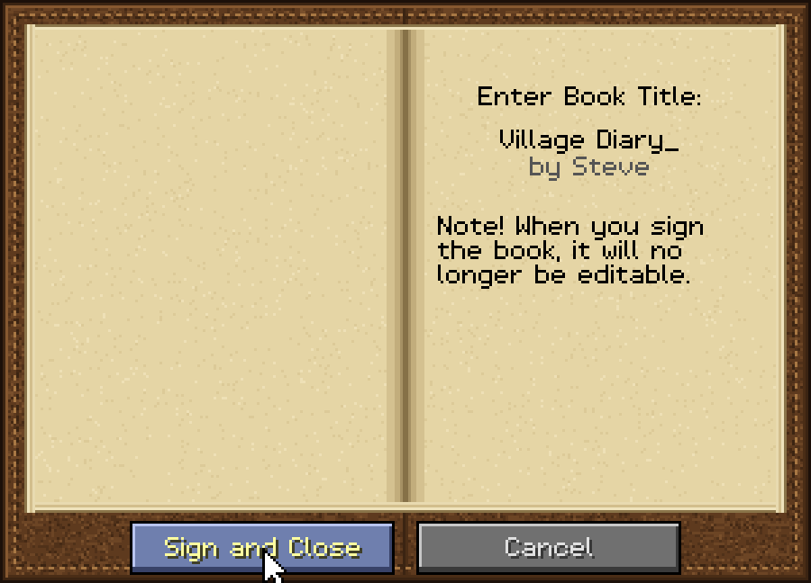
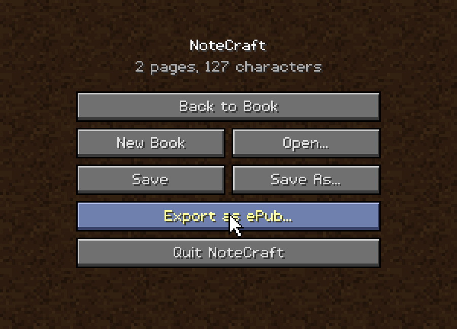
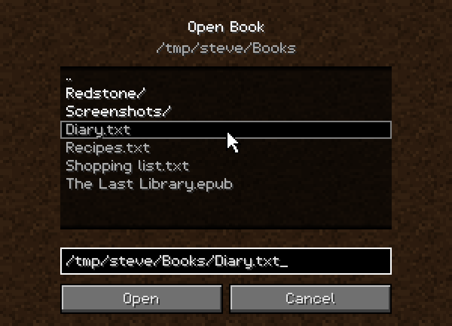

<p align="center">
  
</p>

<p align="center">
  <b>Блокнот «Книга с пером» для Linux.</b><br>
  Выглядит и ведёт себя как книга из Minecraft: те же строки по 114&nbsp;px, 14 строк на странице, 100 страниц, 1&nbsp;023 символа на страницу.<br>
  Маленькая нативная программа на C. Без Electron, без веб-движка, без GUI-тулкитов.
</p>

<p align="center">
  <a href="README.md">English</a>
</p>

<p align="center">
  
</p>

## Скачать

Готовые сборки лежат на **[странице релизов](https://github.com/danielkrinets/NoteCraft/releases/latest)**:

| Платформа | Файл |
|---|---|
| **Arch Linux** (x86_64) | `notecraft-1.1.0-1-x86_64.pkg.tar.zst` — `sudo pacman -U notecraft-*.pkg.tar.zst` |
| **macOS, Apple Silicon** (M1 и новее) | `NoteCraft-1.0.1-macos-apple-silicon.dmg` (или `.zip`) |
| **macOS, Intel** | `NoteCraft-1.0.1-macos-intel.dmg` (или `.zip`) |
| Любой другой Linux (x86_64, aarch64) | `notecraft-1.0.1-linux-<arch>.tar.gz` (нужна `libSDL2`) |

На Arch можно собрать и из исходников: [`packaging/arch/PKGBUILD`](packaging/arch/PKGBUILD), команда `makepkg -si`.

**Первый запуск на macOS:** приложение не подписано сертификатом Apple Developer ID, поэтому Gatekeeper предупредит. Перетащите NoteCraft в *Программы*, затем правый клик → *Открыть* или выполните `xattr -dr com.apple.quarantine /Applications/NoteCraft.app`. SDL2 вшит статически, ничего больше ставить не нужно.

## Возможности

- **Только книга.** Окно — это и есть раскрытая книга: две страницы рядом на кожаной обложке, ничего вокруг. Стрелки страниц, `Page 1 of 4`, мигающий курсор `_`, синее выделение, кнопки **Sign** / **Done** и экран «Enter Book Title». Страницы **перелистываются с анимацией**: лист поднимается, переворачивается через корешок и отбрасывает тень.
- **Ванильные лимиты** (Java Edition): 100 страниц · 1023 символа на страницу · 14 строк · ширина строки 114 px · заголовок до 15 символов. Ввод сверх лимита просто не принимается, как в игре.
- **Ванильный перенос слов** — порт алгоритма `StringSplitter` из Minecraft.
- **Пиксельный шрифт с кириллицей.** Пропорциональный шрифт в стиле Minecraft, нарисованный с нуля (латиница, цифры, знаки, весь русский алфавит, включая `Ёё`, `«»`, `—`, `№`).
- **Текст (`.txt`).** Открытие и сохранение UTF-8. Страницы разделяются символом перевода страницы; текст без разделителей сам раскладывается по страницам.
- **ePub.** Экспорт книги в EPUB 3 (по одному XHTML на страницу) и открытие `.epub`: книги, созданные NoteCraft, возвращаются страница в страницу, любой другой ePub превращается в текст и разбивается на страницы.
- **Страницы.** Две страницы на развороте. Листать — стрелками, `PgUp`/`PgDn` или колесом (последняя стрелка добавляет новый разворот); между левой и правой страницей — `Tab` или клик.
- **Подпись.** *Sign* задаёт название и закрывает книгу от правки (как Written Book); *Unsign* в меню возвращает редактирование.
- **Нативно и компактно.** Рисуется программно в маленький буфер и масштабируется целым числом (как «Auto» GUI scale в Minecraft), поэтому пиксели остаются чёткими на любом экране, включая HiDPI. Перерисовка идёт только при изменениях, поэтому в простое нагрузка на процессор ничтожна.
- **Горячие клавиши не зависят от раскладки**: `Ctrl+C`/`V` работают и на русской раскладке.
- `F2` — скриншот (в `~/Pictures/NoteCraft/`), `F11` — полный экран, можно перетащить файл в окно.

## Скриншоты

| | |
|---|---|
|  |  |
|  |  |
|  |  |

## Сборка из исходников

Нужны компилятор C, **SDL2** и **zlib**.

```sh
# Debian / Ubuntu
sudo apt install build-essential libsdl2-dev zlib1g-dev
# Fedora
sudo dnf install gcc make SDL2-devel zlib-devel
# Arch
sudo pacman -S base-devel sdl2 zlib

git clone https://github.com/danielkrinets/NoteCraft
cd NoteCraft
make
./notecraft                 # запуск на месте
sudo make install           # по желанию: /usr/local/bin + ярлык + иконка
```

## Управление

| Клавиши | Действие |
|---|---|
| `Esc` | Меню / назад |
| `Ctrl+S` / `Ctrl+Shift+S` | Сохранить / Сохранить как (`.txt`) |
| `Ctrl+O` / `Ctrl+N` | Открыть / Новая книга |
| `Ctrl+E` | Экспорт в ePub |
| `Ctrl+Q` | Выход (спросит про несохранённое) |
| `PgUp` / `PgDn`, стрелки, колесо | Предыдущий / следующий разворот |
| `Tab` | Перейти на левую / правую страницу |
| `Ctrl` + `+` / `-` | Изменить размер окна |
| Стрелки, `Home`, `End` | Курсор (с `Ctrl` — по словам / в начало или конец страницы) |
| `Shift` + движение, `Ctrl+A`, двойной клик | Выделение |
| `Ctrl+C` / `X` / `V` | Копировать / вырезать / вставить (то, что не влезает, обрезается) |
| `F2` / `F11` | Скриншот / полный экран |

## Форматы

**`.txt`** — UTF-8. Страницы разделены символом перевода страницы (`U+000C`), каждая заканчивается переводом строки, поэтому файл читается в любом редакторе. Файл без разделителей раскладывается по страницам так, как перенесла бы его сама книга. При импорте табуляция превращается в 4 пробела, CR/LF нормализуется, управляющие символы и `§` отбрасываются. Текст сверх 100 страниц обрезается с предупреждением.

**`.epub`** — экспорт в EPUB 3 плюс NCX для старых читалок; название берётся из подписи (или имени файла), автор — из `$NOTECRAFT_AUTHOR` / `$USER`. Импорт читает любой ePub без DRM: файлы NoteCraft восстанавливаются постранично, остальные сводятся к тексту (картинки и оформление отбрасываются) и разбиваются на страницы.

## Насколько это «1:1»

- **Лимиты** сверены с [Minecraft Wiki](https://minecraft.wiki/w/Book_and_Quill) (Java Edition).
- **Метрики текста и поведение** (поле `114×126`, высота строки 9, перенос слов, проверка правок, перемещение по словам, выделение через `OR_REVERSE`, мигание 300 мс, тексты экрана подписи) повторяют `BookEditScreen` из Java Edition 1.20 в том виде, как я его знаю. Попиксельного сравнения с настоящим клиентом **не делалось**. Ванильный редактор показывает одну страницу; разворот из двух страниц, обложка и анимация перелистывания — собственный дизайн NoteCraft в том же стиле.
- **Текстуры и шрифт нарисованы заново** кодом в манере Minecraft (жёсткие тона, обводка в 1 px, редкий шум): они близки, но не идентичны оригиналу.

## Разработка

```sh
make test             # 400 проверок, SDL не нужен
make demo             # headless-рендерер для скриншотов и демо
tools/make_media.sh   # пересобрать всё в assets/ (нужны python3 и ffmpeg)
```

Ядро (все `src/*.c`, кроме `platform_sdl.c`) не зависит от SDL: приложение целиком рисуется в обычный буфер, так скриншоты и демо делаются из настоящего кода. Тесты также гоняются под ASan/UBSan в CI. Структура ePub проверена скриптом (ZIP, корректность XML, manifest/spine), но через `epubcheck` не прогонялась.

## Юридическое

NoteCraft — неофициальный фан-проект, не связанный с Mojang Studios и Microsoft. *Minecraft* — товарный знак Mojang AB. Ресурсов и кода Minecraft в проекте нет.

## Лицензия

[MIT](LICENSE)
